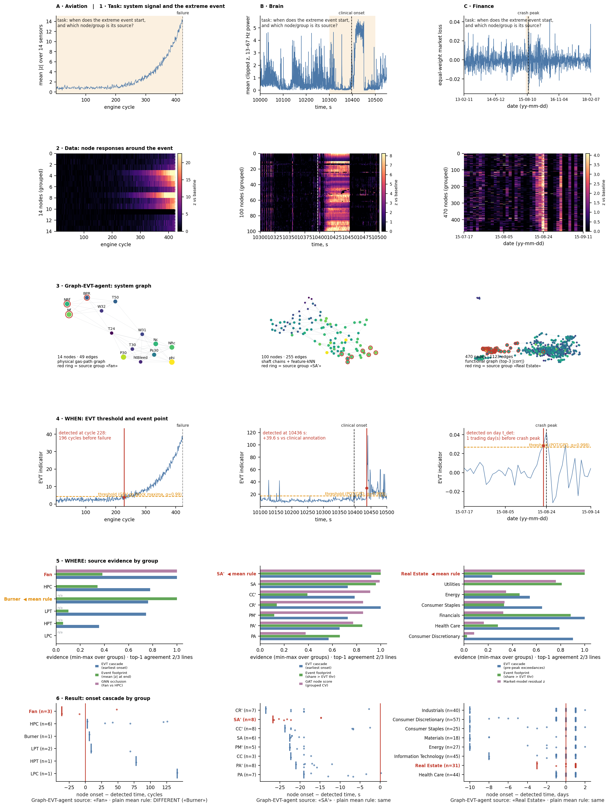

# Graph-EVT-agent: three real-world applications

This repository is an **application showcase** for
[`Graph-EVT-agent`](https://github.com/D2718281828nis/Graph-EVT-agent). It applies the same graph-aware
extreme-value workflow to three very different systems:

| Example | Graph nodes | Signal | Extreme event | Question answered |
|---|---|---|---|---|
| 🧠 **Brain** | sEEG contacts | band power | epileptic seizure | When does the seizure start and which contacts are recruited first? |
| ✈️ **Aviation** | engine sensors | C-MAPSS telemetry | engine degradation | Can the event be detected without leakage and can its source be localized? |
| 📈 **Finance** | S&P 500 companies | market returns | market stress | When does systemic stress begin and through which sectors does it spread? |

Start with the 30-second [`demo/quickstart.py`](demo/quickstart.py), then read the three worked cases. Each
case has the same six-step structure, is written in Russian and English, and has the same six figure types,
so the domains can be compared side by side.

| Case | Document | Six-step figure |
|---|---|---|
| **A** Aviation — turbofan engine failure | [`examples/A_aviation`](examples/A_aviation/README.md) | [`figures/A_six_steps.png`](figures/A_six_steps.png) |
| **B** Medicine — seizure in sEEG | [`examples/B_brain`](examples/B_brain/README.md) | [`figures/B_six_steps.png`](figures/B_six_steps.png) |
| **C** Finance — S&P 500 stress | [`examples/C_finance`](examples/C_finance/README.md) | [`figures/C_six_steps.png`](figures/C_six_steps.png) |

Steps: 1 task · 2 data · 3 Graph-EVT-agent application · 4 how the event point (WHEN) is found ·
5 how the source (WHERE) is found · 6 demonstration. Cross-domain comparison per step:
[`figures/step1_task.png` … `step6_result.png`](figures/), everything at once:
[`figures/all_steps_grid.png`](figures/all_steps_grid.png).



> **Honest reading.** In all three cases EVT locates the event point without leakage and the evidence lines
> mostly agree on the source group. Under leakage-safe splits, however, the graph neural network does *not*
> beat graph-free baselines at node/window classification; the graph's value shown here is localization and
> interpretation. Source "ground truth" is a proxy (A) or absent (B, C). A plain mean of the evidence lines picks the wrong module in A (Burner instead of Fan), the same shaft in B, and is nearly tied/unstable in C. Details are in each case document.

## The shared Graph-EVT-agent workflow

Every example follows the same six stages. Only the domain adapter—nodes, features, graph construction, and
the interpretation of an event—changes.

```text
multichannel time series
        │
        ▼
  windowed node features ──► system graph
        │                         │
        ├──► EVT tail model       ├──► GATv2 / simple baselines
        │    (GEV or POT/GPD)     │    (grouped, leakage-safe CV)
        ▼                         ▼
  event-time detection      node/source localization
        └──────────────┬──────────┘
                       ▼
             interpretable event cascade
```

The reusable library owns the general Graph-EVT method. This repository keeps the domain adapters, dataset
provenance, experiment protocols, figures, and frozen reference results needed to demonstrate that method.
The common application building blocks are collected in [`src/common.py`](src/common.py); each example module
then supplies its domain-specific graph and experiment.

## Quick start

Python 3.11 or newer is recommended.

```bash
python3 -m venv .venv
source .venv/bin/activate
python -m pip install -r requirements.txt

# Download and checksum the public datasets.
python scripts/fetch_data.py

python demo/quickstart.py              # simplest demo (~2 s, no data)
python src/case_figures.py             # regenerate figures/ for A, B, C (needs data/ for A and C)

# Small end-to-end run of all three applications.
python scripts/run_all.py --quick
```

Run one application while developing:

```bash
python scripts/run_all.py --quick --only brain
python scripts/run_all.py --quick --only aviation --jobs 1
python scripts/run_all.py --quick --only finance
```

Run the publication-scale experiments and verify their outputs:

```bash
python scripts/run_all.py
python scripts/compare_results.py
```

Results are written to `results/` (`results_quick/` for a smoke run). Each application produces a
`results.json`; model runs and localization traces are CSV files; logs and environment metadata make a run
auditable. Reference outputs live in `reference_results/{brain,aviation,finance}/`.

> **Why is Graph-EVT-agent installed from GitHub?** The library and this showcase have separate release
> cycles. `requirements.txt` installs the current library directly from its canonical repository, while this
> project remains focused on applications and reproducibility.

## Explore the examples

### 1. Brain: sEEG seizure detection and recruitment

The brain adapter uses sEEG contacts as graph nodes, spectral/temporal measurements as node features, EVT for
seizure-time detection, and graph models for contact-role prediction. A small deterministic synthetic sEEG
file is included for code exploration; the checked research result uses the derived public Zenodo recording.

```bash
python scripts/generate_brain_toy.py
python src/brain_seeg_pipeline.py \
  --data data/sEEG/brain_toy.csv --out results_quick/brain --seeds 0 --epochs 5
```

Entry point: [`src/brain_seeg_pipeline.py`](src/brain_seeg_pipeline.py). Data notes:
[`data/README.md`](data/README.md).

### 2. Aviation: C-MAPSS engine degradation

Sensors become graph nodes; their functional similarity supplies edges. The example contrasts GATv2 with
non-graph baselines under grouped validation, runs EVT detection, and evaluates source localization without
mixing measurements from the same engine across train and test folds.

```bash
python scripts/fetch_data.py --only cmapss
python scripts/run_all.py --quick --only aviation --jobs 1
```

Entry point: [`src/aviation_cmapss_pipeline.py`](src/aviation_cmapss_pipeline.py).

### 3. Finance: systemic stress in the S&P 500

Companies are nodes and their relationships define the market graph. POT/GEV tail modelling detects periods
of stress; graph learning and the detected cascade expose cross-company and cross-sector propagation.

```bash
python scripts/fetch_data.py --only sp500
python scripts/run_all.py --quick --only finance
```

Entry point: [`src/finance_sp500_pipeline.py`](src/finance_sp500_pipeline.py).

## Repository map

```text
src/common.py                    shared Graph-EVT application primitives
src/brain_seeg_pipeline.py       brain adapter and experiment
src/aviation_cmapss_pipeline.py  aviation adapter and experiment
src/finance_sp500_pipeline.py    finance adapter and experiment
src/case_data.py                 one illustrative case per domain in a common structure
src/case_figures.py              the six-step figures (same panel types for A, B, C)
src/make_figures.py              per-example research figures
src/make_generality_figures.py   cross-domain Graph-EVT figures
scripts/fetch_data.py            download, provenance, and checksum checks
scripts/run_all.py               one runner for the three applications
scripts/compare_results.py       reference-output verification
examples/{A_aviation,B_brain,C_finance}/README.md   bilingual six-step case documents
demo/quickstart.py               simplest end-to-end demo
figures/                         generated step figures
reference_results/               checked results for every application
```


## Data and reproducibility

Large datasets are not committed. `scripts/fetch_data.py` obtains public copies and checks their MD5 hashes:

* **Brain:** sEEG recording on Zenodo, DOI `10.5281/zenodo.21967993` (the full EDF is optional when the derived
  dataset is already available).
* **Aviation:** NASA C-MAPSS `FD001` and `FD003`.
* **Finance:** the five-year S&P 500 dataset and a pinned 2018 GICS constituent table.

Paths can be overridden in `.env`; see [`.env.example`](.env.example) and [`config/paths.json`](config/paths.json).
Exact data hashes, expected runtimes, numerical reproducibility notes, and the research-result protocol are
preserved in [`REPRODUCIBILITY.md`](REPRODUCIBILITY.md). Mathematical background is in
[`EVT_THEORY.md`](EVT_THEORY.md), and the worked algorithm explanation is in
[`how-new-aaproach-EVT-works.md`](how-new-aaproach-EVT-works.md).

## Verification

```bash
# Fast syntax and CLI checks (no dataset download).
python -m compileall -q src scripts
python scripts/run_all.py --help

# Full reference verification after fetching data.
python scripts/run_all.py
```

Deterministic EVT, graph, cascade, and localization values are expected to match. Neural-network values can
vary slightly with CPU, operating system, and BLAS implementation; `compare_results.py` reports those
differences separately rather than hiding them.
