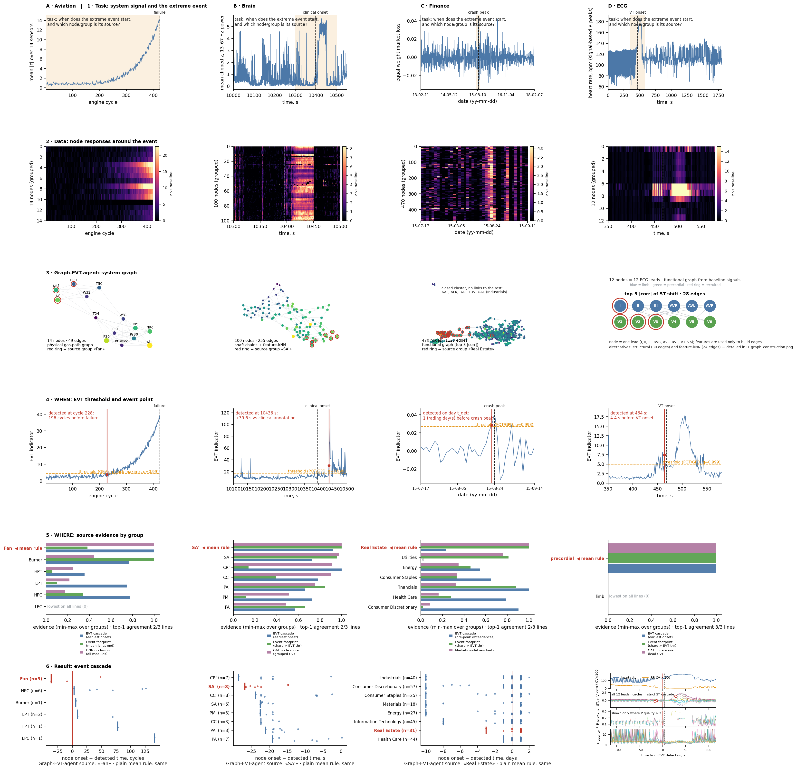

# Graph-EVT-agent: three real-world applications

This repository is an **application showcase** for
[`Graph-EVT-agent`](https://github.com/D2718281828nis/Graph-EVT-agent). It applies the same graph-aware
extreme-value workflow to three very different systems:

| Example | Graph nodes | Signal | Extreme event | Question answered |
|---|---|---|---|---|
| 🧠 **Brain** | sEEG contacts | band power | epileptic seizure | When does the seizure start and which contacts are recruited first? |
| ✈️ **Aviation** | engine sensors | C-MAPSS telemetry | engine degradation | Can the event be detected without leakage and can its source be localized? |
| 📈 **Finance** | S&P 500 companies | market returns | market stress | When does systemic stress begin and through which sectors does it spread? |

Start with the 30-second [`demo/quickstart.py`](demo/quickstart.py), then read the four worked cases. Each
case has the same six-step structure and figure types, so the domains can be compared side by side.

| Case | Document | Six-step figure |
|---|---|---|
| **A** Aviation — turbofan engine failure | [`examples/A_aviation`](examples/A_aviation/README.md) | [`figures/A_six_steps.png`](figures/A_six_steps.png) |
| **B** Medicine — seizure in sEEG | [`examples/B_brain`](examples/B_brain/README.md) | [`figures/B_six_steps.png`](figures/B_six_steps.png) |
| **C** Finance — S&P 500 stress | [`examples/C_finance`](examples/C_finance/README.md) | [`figures/C_six_steps.png`](figures/C_six_steps.png) |
| **D** ECG — 31 VT episodes across 75 INCART recordings | [`examples/D_ecg`](examples/D_ecg/README.md) | [`D_six_steps.png`](figures/D_six_steps.png), [`D_graph_construction.png`](figures/D_graph_construction.png), [`D_parameter_cascade.png`](figures/D_parameter_cascade.png) |

Steps: 1 task · 2 data · 3 Graph-EVT-agent application · 4 how the event point (WHEN) is found ·
5 how the source (WHERE) is found · 6 demonstration. Cross-domain comparison per step:
[`figures/step1_task.png` … `step6_result.png`](figures/), everything at once:
[`figures/all_steps_grid.png`](figures/all_steps_grid.png).



> **Honest reading.** In all three cases EVT locates the event point without leakage and the evidence lines
> mostly agree on the source group. Under leakage-safe splits, however, the graph neural network does *not*
> beat graph-free baselines at node/window classification; the graph's value shown here is localization and
> interpretation. Source "ground truth" is a proxy (A) or absent (B, C). A plain mean of the evidence lines picks the same module in A (Fan, with a small margin over Burner) and the same shaft in B, and is nearly tied/unstable in C, so an advantage of the graph score over a plain mean is not shown. Details are in each case document.

### Headline numbers (reference results)

These come from `reference_results/*/results.json`. On 2026-11-02 they were checked against the dissertation's
computation core: every core key matches (see [Verification](#verification)).

| System | Detection without labels ("when") | False alarms |
|---|---|---|
| 🧠 Brain | blind POT alarm 39.6 s after the clinical seizure mark | 0 in 1.87 h of test signal (GEV: 2 false alarms) |
| ✈️ Aviation | alarm in 100 of 100 engines, median lead 98 cycles before failure (GEV) | indicator and thresholds fitted on cycles 1–30, alarms counted on 31–60: 7 of 100 engines (POT), 35 of 100 (GEV) |
| 📈 Finance | 7 extreme days against 1.5 expected (binomial p = 0.001) | after declustering, 6…4 clusters, p = 0.005…0.068 depending on the gap |

`src/aviation_false_alarm_bootstrap.py` tests where the aviation false alarms come from: the cause is the short
background, not dependent exceedances (`reference_results/aviation/false_alarm_bootstrap.json`).

## The shared Graph-EVT-agent workflow

Every example follows the same six stages. Only the domain adapter—nodes, features, graph construction, and
the interpretation of an event—changes.

```text
multichannel time series
        │
        ▼
  windowed node features ──► system graph
        │                         │
        ├──► EVT tail model       ├──► GATv2 / simple baselines
        │    (GEV or POT/GPD)     │    (grouped, leakage-safe CV)
        ▼                         ▼
  event-time detection      node/source localization
        └──────────────┬──────────┘
                       ▼
             interpretable event cascade
```

The reusable library owns the general Graph-EVT method. This repository keeps the domain adapters, dataset
provenance, experiment protocols, figures, and frozen reference results needed to demonstrate that method.
The common application building blocks are collected in [`src/common.py`](src/common.py); each example module
then supplies its domain-specific graph and experiment.

## Quick start

Python 3.11 or newer is recommended.

```bash
python3 -m venv .venv
source .venv/bin/activate
python -m pip install -r requirements.txt

# Download and checksum the public datasets.
python scripts/fetch_data.py

python demo/quickstart.py              # simplest demo (~2 s, no data)
python src/case_figures.py             # regenerate figures/ for A, B, C, D (needs data/ for A, C, D)

# Small end-to-end run of all three applications.
python scripts/run_all.py --quick
```

Run one application while developing:

```bash
python scripts/run_all.py --quick --only brain
python scripts/run_all.py --quick --only aviation --jobs 1
python scripts/run_all.py --quick --only finance
```

Run the publication-scale experiments and verify their outputs:

```bash
python scripts/run_all.py
python scripts/compare_results.py
```

Results are written to `results/` (`results_quick/` for a smoke run). Each application produces a
`results.json`; model runs and localization traces are CSV files; logs and environment metadata make a run
auditable. Reference outputs live in `reference_results/{brain,aviation,finance}/`; the additional ECG reference is `reference_results/ecg/` and is not part of the three-system comparison.

> **Why is Graph-EVT-agent installed from GitHub?** The library and this showcase have separate release
> cycles. `requirements.txt` installs the current library directly from its canonical repository, while this
> project remains focused on applications and reproducibility.

## Explore the examples

### 1. Brain: sEEG seizure detection and recruitment

The brain adapter uses sEEG contacts as graph nodes, spectral/temporal measurements as node features, EVT for
seizure-time detection, and graph models for contact-role prediction. A small deterministic synthetic sEEG
file is included for code exploration; the checked research result uses the derived public Zenodo recording.

```bash
python scripts/generate_brain_toy.py
python src/brain_seeg_pipeline.py \
  --data data/sEEG/brain_toy.csv --out results_quick/brain --seeds 0 --epochs 5
```

Entry point: [`src/brain_seeg_pipeline.py`](src/brain_seeg_pipeline.py). Data notes:
[`data/README.md`](data/README.md).

### 2. Aviation: C-MAPSS engine degradation

Sensors become graph nodes; their functional similarity supplies edges. The example contrasts GATv2 with
non-graph baselines under grouped validation, runs EVT detection, and evaluates source localization without
mixing measurements from the same engine across train and test folds.

```bash
python scripts/fetch_data.py --only cmapss
python scripts/run_all.py --quick --only aviation --jobs 1
```

Entry point: [`src/aviation_cmapss_pipeline.py`](src/aviation_cmapss_pipeline.py).

### 3. Finance: systemic stress in the S&P 500

Companies are nodes and their relationships define the market graph. POT/GEV tail modelling detects periods
of stress; graph learning and the detected cascade expose cross-company and cross-sector propagation.

```bash
python scripts/fetch_data.py --only sp500
python scripts/run_all.py --quick --only finance
```

Entry point: [`src/finance_sp500_pipeline.py`](src/finance_sp500_pipeline.py).

### 4. ECG: ventricular tachycardia across 75 INCART recordings

The ECG adapter uses all **75 INCART recordings**, downloaded and SHA-256-verified by the data script. Eight recordings contain 31 eligible VT episodes. Raw ECG becomes exactly four nodes per episode: RR, clinical PR and ST elevation from lead II, plus the frontal QRS axis from I and aVF. The 6-MAD/two-250-ms-window cascade yields **52 episode-parameter recruitment points**. Record-grouped validation keeps episodes from the same recording out of both train and test; physiological GAT does not beat the empty graph (AUROC 0.473 ± 0.046 versus 0.458 ± 0.017). I42 is retained only for representative signal figures.

```bash
python scripts/fetch_data.py --only incart
python scripts/run_all.py --only ecg
```

Entry point: [`src/ecg_incart_pipeline.py`](src/ecg_incart_pipeline.py). Worked case: [`examples/D_ecg`](examples/D_ecg/README.md).

## Repository map

```text
src/common.py                    shared Graph-EVT application primitives, incl. the shared detector common.detect
config/systems.json              R1-protected detector specification for the three original systems
config/ecg.json                  detector specification for the multi-record ECG example
src/brain_seeg_pipeline.py       brain adapter and experiment
src/ecg_incart_pipeline.py       75-record ECG → four series per episode, graphs, EVT and recruitment points
src/aviation_cmapss_pipeline.py  aviation adapter and experiment
src/finance_sp500_pipeline.py    finance adapter and experiment
src/folds.py                     platform-independent fold composition
src/aviation_false_alarm_bootstrap.py  aviation: where healthy-segment false alarms come from
src/case_data.py                 one illustrative case per domain in a common structure
src/case_figures.py              the six-step figures for A, B, C, D and detailed ECG graph construction
src/make_figures.py              per-example research figures
src/make_generality_figures.py   cross-domain Graph-EVT figures
scripts/fetch_data.py            download, provenance, and checksum checks
scripts/run_all.py               one runner for the three applications; optional ECG via --only ecg
scripts/compare_results.py       reference-output verification (fold MD5 first)
scripts/check_sync_with_r1.py    reference vs the dissertation core (dissertation-calculations)
tests/                           fold composition; reference sync and ECG feature parsing
examples/{A_aviation,B_brain,C_finance,D_ecg}/README.md   bilingual case documents
demo/quickstart.py               simplest end-to-end demo
figures/                         generated step figures
reference_results/               checked results for every application; R1_SYNC.json records the sync check
```


## Data and reproducibility

Large datasets are not committed. `scripts/fetch_data.py` obtains public copies and checks their MD5 or SHA-256 hashes:

* **Brain:** sEEG recording on Zenodo, DOI `10.5281/zenodo.21967993` (the full EDF is optional when the derived
  dataset is already available).
* **Aviation:** NASA C-MAPSS `FD001` and `FD003`.
* **Finance:** the five-year S&P 500 dataset and a pinned 2018 GICS constituent table.
* **Additional ECG case:** INCART v1.0.0, DOI `10.13026/C2V88N`; all 75 records `I01–I75.dat/.hea/.atr` plus the official SHA-256 manifest, downloaded separately with `--only incart`.

Paths can be overridden in `.env`; see [`.env.example`](.env.example) and [`config/paths.json`](config/paths.json).
Exact data hashes, expected runtimes, numerical reproducibility notes, and the research-result protocol are
preserved in [`REPRODUCIBILITY.md`](REPRODUCIBILITY.md). Mathematical background is in
[`EVT_THEORY.md`](EVT_THEORY.md), and the worked algorithm explanation is in
[`how-new-aaproach-EVT-works.md`](how-new-aaproach-EVT-works.md).

## Verification

```bash
# Fast checks (no dataset download): fold composition and an unchanged reference. Same as CI.
pip install pytest && pytest -q tests
python -m compileall -q src scripts
python scripts/run_all.py --help

# Full reference verification after fetching data.
python scripts/run_all.py              # ends with scripts/compare_results.py

# Against the dissertation core, if you have a local copy of it next to this repository.
python scripts/check_sync_with_r1.py --r1 ../dissertation-calculations
```

* **Fold composition comes first.** Every grouped split is built by `src/folds.py` (`stable_group_kfold`), not by
  `sklearn`'s `GroupKFold`, whose order of equal-sized groups depended on the platform's sort. Each run writes
  `folds.csv` and its MD5 to `results.json → folds_md5`; `compare_results.py` treats an MD5 mismatch as an error.
* **Deterministic values** (EVT detection, graphs, cascade, localization without neural networks) are expected to
  match on any machine.
* **Neural-network values** can vary slightly with CPU, operating system, and BLAS implementation;
  `compare_results.py` reports those differences separately rather than hiding them. `run_all.py` runs every
  process with one thread (`OMP_NUM_THREADS=1`), as the reference was computed; only then do GNN numbers match bit
  for bit on the same machine.
* **Sync with the dissertation core (2026-11-02).** The reference was recomputed with this repository's own code and
  matches the core on every one of its keys: brain 412, aviation 489, finance 484, with identical `folds.csv` MD5
  ([`reference_results/R1_SYNC.json`](reference_results/R1_SYNC.json)). This repository's own additions (toy brain
  data, occlusion of all aviation modules) only add new keys.

## What stays in the dissertation core

This showcase keeps the three applications. The following checks were run on the same data in the dissertation's
computation core (`dissertation-calculations`) and are not repeated here:

* **Graph hypotheses.** The graphs used here (structural/physical/sector, functional, kNN) plus cross-DFA, Morlet
  phase synchrony, their ensemble, partial correlation and conditional Granger causality, each tested against an
  empty graph under transductive and inductive protocols. None is confirmed on any system under grouped splits
  (partial correlation and Granger are not applicable to the 60 × 470 finance windows).
* **Alarm rule and outlier detectors.** Expected against observed false alarms (ARL₀, onset bias, extremal index);
  one-class SVM, LNND, kNN, LOF and isolation forest, and the two-stage scheme, on the brain and aviation data.
* **Feature-space criteria.** Tail heaviness per engine as a predictor of detectability, and DFA against spectral
  features for classifying records. On C-MAPSS engine records DFA is worse than the spectrum at every record length
  tested. On sEEG records (positive control) DFA beats a coarse spectrum but is not significantly better than
  physiological EEG bands.
