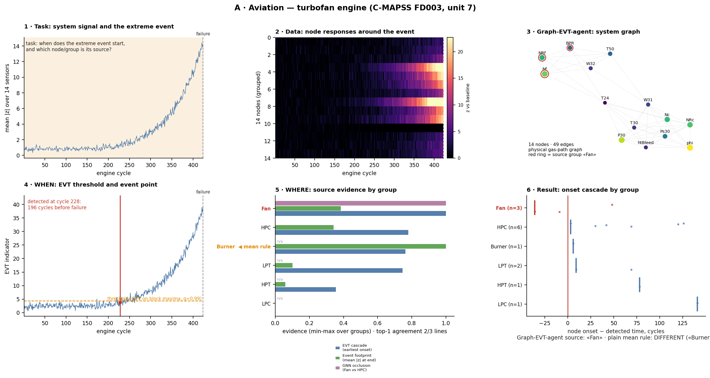

# A · Авиация / Aviation — отказ турбовентиляторного двигателя / turbofan engine failure

Рисунки / Figures: [A_six_steps.png](../../figures/A_six_steps.png) · сравнение A|B|C по шагам / cross-domain per step: [step1…step6](../../figures/) · сводка / all: [all_steps_grid.png](../../figures/all_steps_grid.png)
Воспроизведение / Reproduce: `python scripts/fetch_data.py --only cmapss && python src/case_figures.py --only A`

---

## 1. Постановка задачи / Problem statement

**RU.** Двигатель деградирует от здорового состояния до отказа. Нужно (а) **когда** деградация становится экстремальной — найти точку события по 14 датчикам без использования будущего; (б) **где** она началась — в каком узле газовоздушного тракта (Fan или HPC; два режима отказа набора FD003). Показан двигатель №7 из FD003 (иллюстрация; агрегаты по всем 100 двигателям — в п. 6).

**EN.** An engine degrades from healthy to failure. We need (a) **when** the degradation becomes extreme — an event point from 14 sensors without using the future; (b) **where** it started — which gas-path module (Fan or HPC; the two failure modes of FD003). Engine #7 of FD003 is shown as an illustration; statistics over all 100 engines are in §6.

## 2. Описание данных / Data description

**RU.** NASA C-MAPSS (Saxena et al., 2008), `train_FD001.txt` (100 двигателей, один режим отказа) и `train_FD003.txt` (100 двигателей, два режима: деградация HPC или Fan). Цикл = один полёт; 14 информативных датчиков (T24, T30, T50, P30, Nf, Nc, Ps30, phi, NRf, NRc, BPR, htBleed, W31, W32). Фон = первые 60 циклов каждого двигателя. Ряды стандартизуются по фону. Загрузка и MD5: `scripts/fetch_data.py`. Двигатель №7: 424 цикла.

**EN.** NASA C-MAPSS (Saxena et al., 2008): `train_FD001.txt` (100 engines, one failure mode) and `train_FD003.txt` (100 engines, two modes: HPC or Fan degradation). One cycle = one flight; 14 informative sensors. Baseline = the first 60 cycles of each engine; series are standardised on the baseline. Download and MD5 checks: `scripts/fetch_data.py`. Engine #7: 424 cycles.

## 3. Применение graph-EVT-agent / Applying graph-EVT-agent

**RU.** Узлы графа — датчики (14), рёбра — физический граф газовоздушного тракта (датчики одного модуля и соседних модулей: Fan–LPC–HPC–Burner–HPT–LPT плюс валы), 49 рёбер. Узловые признаки в окнах 30 циклов: среднее, наклон, остаточный шум, автокорреляция. Агент выполняет шаги: вход → EVT-детекция точки → граф → ранжирование источника → (опционально) ГНС GATv2. Код предметной части: `src/aviation_cmapss_pipeline.py`, общие функции: `src/common.py`.

**EN.** Graph nodes are the 14 sensors; edges form the physical gas-path graph (sensors of one module and of adjacent modules: Fan–LPC–HPC–Burner–HPT–LPT plus shafts), 49 edges. Node features per 30-cycle window: mean, slope, residual noise, autocorrelation. The agent runs: input → EVT event detection → graph → source ranking → (optional) GATv2 GNN. Domain code: `src/aviation_cmapss_pipeline.py`; shared functions: `src/common.py`.

## 4. Методика поиска точки наступления события / How the event point is found

**RU.**
1. Индикатор состояния: расстояние Махаланобиса от фонового среднего с ковариацией Ледойта–Вольфа по 14 датчикам → один скалярный ряд.
2. Блочные максимумы (блок 3 цикла) на фоне → подгонка GEV (ML с несколькими стартами) → порог — квантиль 0,99.
3. Правило устойчивости: первый блок, с которого максимумы выше порога 2 раза подряд, → точка события. Параллельный вариант: POT/GPD (порог по квантилю 0,8, уровень 0,999, 3 подряд).
4. Параметры порога оцениваются **только по фону** (без утечки будущего).

Двигатель №7: порог GEV = 4,32, событие обнаружено на цикле **228**, за **196 циклов до отказа**.

**EN.**
1. State indicator: Mahalanobis distance from the baseline mean with Ledoit–Wolf covariance over the 14 sensors → one scalar series.
2. Block maxima (3-cycle blocks) on the baseline → GEV fit (ML, several starts) → threshold at the 0.99 quantile.
3. Persistence rule: the first block after which maxima exceed the threshold twice in a row → event point. Parallel variant: POT/GPD (threshold at 0.8 quantile, level 0.999, 3 in a row).
4. Threshold parameters are estimated **from the baseline only** (no future leakage).

Engine #7: GEV threshold = 4.32, event detected at cycle **228**, **196 cycles before failure**.

## 5. Методика поиска источника события / How the source is found

**RU.** Три линии доказательств по группам узлов (модулям), каждая нормируется к [0, 1]:
1. **Каскад EVT** — для каждого датчика первое устойчивое превышение собственного GEV-порога |z|; модуль-источник — с самым ранним датчиком.
2. **След события** — средний |z| датчиков модуля в конце жизни.
3. **Графовая модель (ГНС GATv2)** — окклюзионная значимость: насколько падает логит критичности, если обнулить признаки узлов модуля (Fan против HPC), обучение с группировкой по двигателям.

Источник агента = верх третьей линии (в рисунках — красный; оранжевый — победитель простого среднего по линиям); первые две — проверки согласованности. Эталон для сравнения — сигнатура датчиков (знаки откликов, откалиброванные на FD001, где единственный режим — HPC); это **прокси**-метка, а не истина из набора данных.

**EN.** Three evidence lines per node group (module), each min-max normalised:
1. **EVT cascade** — per sensor, the first persistent exceedance of its own GEV threshold on |z|; the source module holds the earliest sensor.
2. **Event footprint** — mean |z| of the module's sensors at end of life.
3. **Graph model (GATv2 GNN)** — occlusion importance: how much the criticality logit drops if the module's node features are zeroed (Fan vs HPC), trained with engine-grouped CV.

Agent source = top of the third line (red in figures; orange = winner of the plain mean over lines); the first two are consistency checks. The comparison reference is the sensor signature (response signs calibrated on FD001, where the only mode is HPC) — a **proxy** label, not ground truth from the dataset.

**RU. Сравнение с обычной статистикой (среднее по линиям).** Если вместо графовой модели взять простое среднее трёх линий (отсутствующие — пропустить), источником станет **Burner** (0,88 против 0,79 у Fan) — **ошибка**: эталонная сигнатура указывает Fan. Причина: у Burner один датчик (phi) с огромным «следом» в конце жизни, у него нет оценки ГНС (линия пропускается), и среднее не умеет отличить «громкий» узел от «ранней причины». Графовая оценка (окклюзия по модулям) даёт Fan. Это согласуется со статистикой по 100 двигателям: каскад EVT совпадает с сигнатурой в 52 %, ГНС — в 89 %. Оговорка: правило среднего — моя простая конструкция, а не оптимально подобранный статистический метод; эталон — прокси.

**EN. Comparison with ordinary statistics (mean over lines).** If, instead of the graph model, we take the plain mean of the three lines (missing ones skipped), the source becomes **Burner** (0.88 vs 0.79 for Fan) — **wrong**: the reference signature says Fan. Why: Burner has a single sensor (phi) with a huge end-of-life footprint and no GNN estimate (that line is skipped), and a mean cannot tell a "loud" node from an early cause. The graph score (module occlusion) gives Fan. This matches the 100-engine statistics: the EVT cascade agrees with the signature in 52 %, the GNN in 89 %. Caveat: the mean rule is my simple construction, not an optimally tuned statistical method; the reference is a proxy.

## 6. Демонстрация решения / Demonstration of the solution

**RU.** Двигатель №7: точка события — цикл 228 (за 196 циклов до отказа); самые ранние датчики — BPR, Nf (Fan) и NRc (HPC); ГНС, каскад и сигнатура указывают **Fan**.
Итоги по всем 100 двигателям (`reference_results/aviation/results.json`):
* детекция GEV: 100/100, медиана упреждения 98 циклов (IQR 69–116), POT: 99/100, 76 циклов; ложные тревоги на «здоровом» участке: GEV 8/100, POT 0/100;
* источник: ГНС совпадает с сигнатурой в **89 %**, **каскад EVT — в 52 %** (на уровне случайного: одной хронологии появления превышений недостаточно для различения Fan/HPC);
* AUPRC (группировка по двигателям): GATv2 с физическим графом 0,942, без рёбер 0,949, LR 0,937 — **граф не даёт заметного выигрыша над табличными моделями**; ценность графа здесь — в интерпретации (окклюзия по модулям), а не в росте метрики.

**EN.** Engine #7: event point at cycle 228 (196 cycles before failure); earliest sensors BPR, Nf (Fan) and NRc (HPC); the GNN, the cascade and the signature all point to **Fan**.
Totals over all 100 engines (`reference_results/aviation/results.json`):
* GEV detection: 100/100, median lead 98 cycles (IQR 69–116); POT: 99/100, 76 cycles; false alarms on the healthy segment: GEV 8/100, POT 0/100;
* source: the GNN agrees with the signature in **89 %**, the **EVT cascade in 52 %** (chance level: onset chronology alone does not separate Fan from HPC);
* AUPRC (engine-grouped CV): GATv2 with the physical graph 0.942, no edges 0.949, LR 0.937 — **the graph gives no clear gain over tabular models**; its value here is interpretability (module occlusion), not a metric increase.

