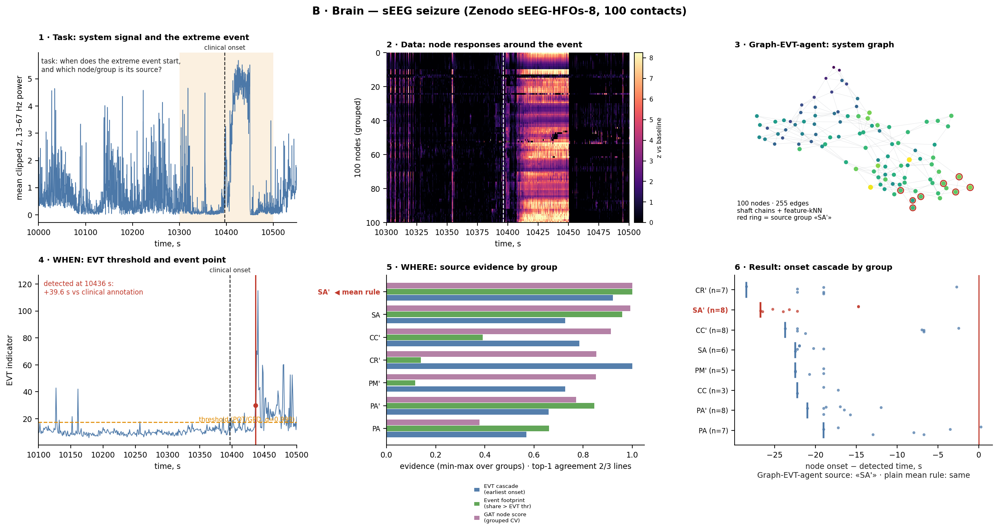

# B · Медицина (мозг) / Medicine (brain) — эпилептический приступ в sEEG / epileptic seizure in sEEG

Рисунки / Figures: [B_six_steps.png](../../figures/B_six_steps.png) · [step1…step6](../../figures/) · [all_steps_grid.png](../../figures/all_steps_grid.png)
Воспроизведение / Reproduce: `python src/case_figures.py --only B` (читает замороженные результаты `reference_results/brain/`; полный расчёт: `python scripts/run_all.py --only brain` при наличии производного набора / full run needs the derived dataset, see `data/README.md`).

---

## 1. Постановка задачи / Problem statement

**RU.** В записи стерео-ЭЭГ (SEEG) пациента с фармакорезистентной эпилепсией произошёл приступ (аннотация врача: 10396,4 с). Нужно (а) **когда** активность мозга становится экстремальной, без заранее известного времени приступа; (б) **где** — какие электроды (стержни/контакты) вовлекаются первыми, т.е. кандидаты на очаг. Это исследовательская демонстрация метода на одном пациенте, а не диагностический инструмент.

**EN.** A stereo-EEG (sEEG) recording of a patient with drug-resistant epilepsy contains one seizure (clinician annotation: 10396.4 s). We need (a) **when** brain activity becomes extreme, without knowing the seizure time in advance; (b) **where** — which electrodes (shafts/contacts) are recruited first, i.e. candidate onset-zone sites. This is a research demonstration on one patient, not a diagnostic tool.

## 2. Описание данных / Data description

**RU.** Открытая запись Zenodo `sEEG-HFOs-8.edf`, DOI 10.5281/zenodo.21967993 (MD5 EDF проверяется): 100 контактов на 12 стержнях (SA', CC', PA, …), левое/правое полушарие, ~10 550 с. Производные ряды: мощность в полосах по секундам; фон = первый час (0–3600 с). Для каскада — z-оценка мощности 13–67 Гц в окнах 250 мс относительно 290 с перед событием. Полная запись не хранится в репозитории; для кода без данных есть синтетический `data/sEEG/brain_toy.csv` (не для выводов).

**EN.** Open Zenodo recording `sEEG-HFOs-8.edf`, DOI 10.5281/zenodo.21967993 (EDF MD5 is checked): 100 contacts on 12 shafts (SA', CC', PA, …), left/right hemisphere, ~10 550 s. Derived series: per-second band power; baseline = the first hour (0–3600 s). For the cascade: z-score of 13–67 Hz power in 250 ms windows against the 290 s before the event. The full recording is not stored in the repository; a synthetic `data/sEEG/brain_toy.csv` lets the code run without it (not for conclusions).

## 3. Применение graph-EVT-agent / Applying graph-EVT-agent

**RU.** Узлы — 100 контактов. Рёбра — (i) структурные: соседние контакты вдоль одного стержня; (ii) kNN в пространстве узловых признаков (11 признаков: мощность в 5 диапазонах, DFA, автокорреляция и др.): всего 255 рёбер. Метка узла — «вовлечён в приступ» (есть устойчивое превышение в каскаде): 54 из 100. Код: `src/brain_seeg_pipeline.py`.

**EN.** Nodes are the 100 contacts. Edges: (i) structural — neighbouring contacts along one shaft; (ii) kNN in node-feature space (11 features: five band powers, DFA, autocorrelation, …): 255 edges in total. Node label = "recruited into the seizure" (a persistent exceedance in the cascade): 54 of 100. Code: `src/brain_seeg_pipeline.py`.

## 4. Методика поиска точки наступления события / How the event point is found

**RU.**
1. Индикатор: расстояние Махаланобиса (ковариация Ледойта–Вольфа) широкополосной лог-мощности 100 контактов относительно первого часа.
2. Порог POT/GPD: хвост выше квантиля 0,8 фона → GPD → уровень 0,999 → порог 17,16.
3. Правило устойчивости: 3 секунды подряд выше порога → событие. Запасной вариант: GEV по блочным максимумам 10 с (даёт ложные тревоги, см. п. 6).
4. Всё оценивается по фону; интервал до события не используется.

Результат: событие обнаружено на **10436 с**, **+39,6 с** относительно аннотации врача; ложных тревог POT на проверочном интервале 0.

**EN.**
1. Indicator: Mahalanobis distance (Ledoit–Wolf covariance) of the 100 contacts' broadband log-power against the first hour.
2. POT/GPD threshold: the tail above the 0.8 baseline quantile → GPD → level 0.999 → threshold 17.16.
3. Persistence rule: 3 consecutive seconds above the threshold → event. Fallback: GEV on 10 s block maxima (produces false alarms, see §6).
4. Everything is estimated on the baseline; the pre-event interval is not used.

Result: event detected at **10436 s**, **+39.6 s** after the clinician annotation; POT false alarms on the test interval: 0.

## 5. Методика поиска источника события / How the source is found

**RU.** Три линии доказательств по стержням (группам контактов), нормируются к [0, 1]:
1. **Каскад EVT** — для каждого контакта первое устойчивое (2 окна по 250 мс) превышение z > 6 робастных σ (MAD); стержень — по самой ранней латентности.
2. **След события** — доля секунд приступа, когда контакт превышает собственный POT-порог (по фону).
3. **GAT-оценка узла** — GATv2 на структурном графе предсказывает «вовлечён ли контакт»; оценки out-of-fold при разбиении **с группировкой по стержням** (предсказание для стержня не видит его самого при обучении).

Источник агента = верх третьей линии (в рисунках — красный; оранжевый — победитель простого среднего по линиям); остальные — проверки согласованности.

**EN.** Three evidence lines per shaft (contact group), min-max normalised:
1. **EVT cascade** — per contact, the first persistent (2 × 250 ms windows) exceedance of z > 6 robust σ (MAD); the shaft is ranked by its earliest latency.
2. **Event footprint** — the share of seizure seconds in which the contact exceeds its own baseline POT threshold.
3. **GAT node score** — GATv2 on the structural graph predicts "is the contact recruited"; out-of-fold scores under **shaft-grouped** splitting (a shaft's prediction never saw that shaft in training).

Agent source = top of the third line (red in figures; orange = winner of the plain mean over lines); the others are consistency checks.

**RU. Сравнение с обычной статистикой (среднее по линиям).** Простое среднее трёх линий даёт тот же стержень **SA'** (0,97; второй — SA, 0,89). Здесь правило среднего **не ошибается**, и преимущество графовой модели на этом пациенте **не показано**; выводы осторожны: один пациент, независимой истины об очаге нет.

**EN. Comparison with ordinary statistics (mean over lines).** The plain mean of the three lines gives the same shaft, **SA'** (0.97; runner-up SA, 0.89). The mean rule is **not wrong** here, so an advantage of the graph model is **not demonstrated** on this patient; conclusions stay cautious: one patient, no independent ground truth for the onset zone.

## 6. Демонстрация решения / Demonstration of the solution

**RU.** Источник — стержень **SA'** (стержень левого полушария по принятому в коде соглашению об апострофе; анатомическая привязка в данных не используется и требует врача). Он лидирует по следу события (0,92 контактов-секунд) и по GAT (0,99); по самой ранней латентности лидирует CR' (CR'1, +11,1 с), SA' идёт вторым с 4 из 10 самых ранних контактов (SA'8 +12,8 с, SA'7 +13,1 с, SA'6 +14,3 с, SA'5 +15,6 с). Согласие top-1: 2 из 3 линий; остаточная z-оценка (независимая) тоже указывает SA'. Таким образом, оценка источника устойчива, но не однозначна.
Ограничения (`reference_results/brain/results.json`): GEV по блокам даёт 2 ложные тревоги (1,07/ч; одна — на плоском сигнале), POT — 0. AUROC узловой классификации при группировке по стержням: GAT со структурным графом 0,868, без рёбер 0,867, логистическая регрессия 0,879 — **граф не даёт выигрыша** при честном разбиении (выигрыш +0,03 только при случайном разбиении, т.е. за счёт утечки соседей). Один пациент и одно событие: это демонстрация, а не валидация.

**EN.** The source is shaft **SA'** (a left-hemisphere shaft by the code's apostrophe convention; no anatomical mapping is used and one needs a clinician). It leads on event footprint (0.92) and on the GAT score (0.99); by earliest latency CR' leads (CR'1, +11.1 s), and SA' is second with 4 of the 10 earliest contacts (SA'8 +12.8 s, SA'7 +13.1 s, SA'6 +14.3 s, SA'5 +15.6 s). Top-1 agreement: 2 of 3 lines; the independent residual-z estimate also points to SA'. The source estimate is therefore robust but not unique.
Limitations (`reference_results/brain/results.json`): block GEV yields 2 false alarms (1.07/h; one on a flat signal), POT yields 0. Node-classification AUROC under shaft-grouped splits: GAT with structural graph 0.868, no edges 0.867, logistic regression 0.879 — **the graph gives no gain** under honest splitting (+0.03 only with random splitting, i.e. via neighbour leakage). One patient, one event: a demonstration, not a validation.

