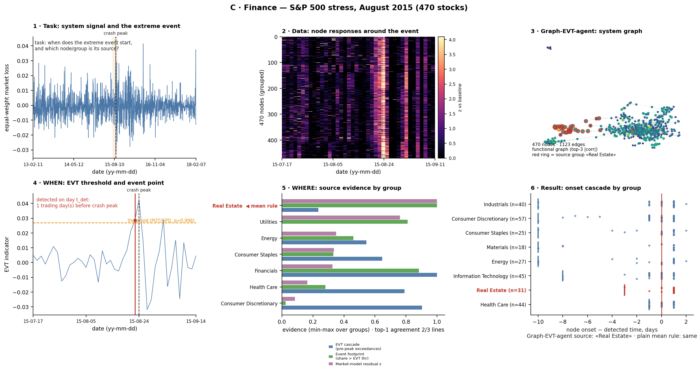
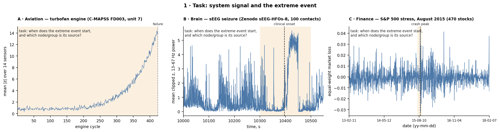
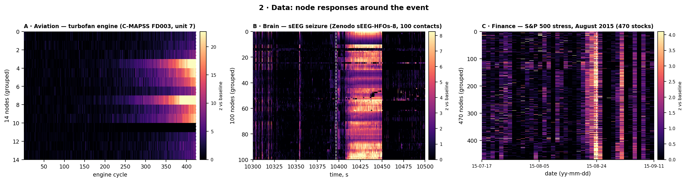
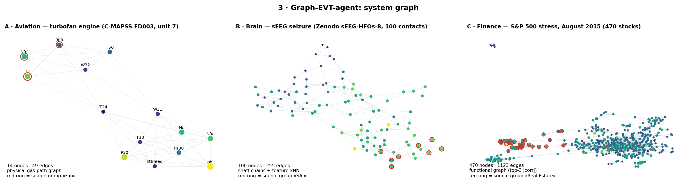
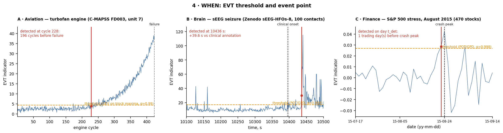
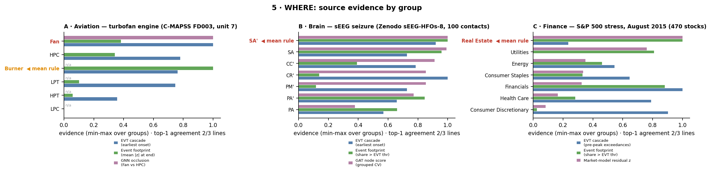
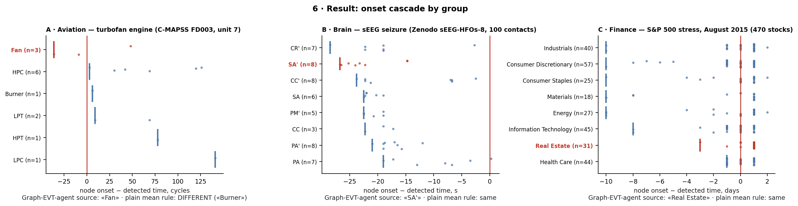

# C · Финансы / Finance — рыночный стресс S&P 500, август 2015 / S&P 500 market stress, August 2015

Рисунки / Figures: [C_six_steps.png](../../figures/C_six_steps.png) · [step1…step6](../../figures/) · [all_steps_grid.png](../../figures/all_steps_grid.png)
Воспроизведение / Reproduce: `python scripts/fetch_data.py --only sp500 && python src/case_figures.py --only C`

---

## 1. Постановка задачи / Problem statement

**RU.** Фондовый рынок — сеть акций, связанных общими факторами. Нужно (а) **когда** в рыночных потерях начинается экстремальный эпизод (без знания будущих дат); (б) **через какой сектор** стресс вошёл в рынок и распространился. Разобран эпизод августа 2015 (пик потерь 24.08.2015); в базе ещё три эпизода (2016-06, 2016-09, 2018-02, `reference_results/finance/`).

**EN.** The stock market is a network of stocks tied by common factors. We need (a) **when** an extreme episode starts in market losses (without knowing future dates); (b) **through which sector** the stress entered and spread. The August 2015 episode is analysed (loss peak 2015-08-24); three more episodes (2016-06, 2016-09, 2018-02) are in `reference_results/finance/`.

## 2. Описание данных / Data description

**RU.** Kaggle «S&P 500 stock data» (`all_stocks_5yr.csv`, 2013-02-08…2018-02-07, MD5 проверяется) — 470 акций с полным рядом; секторы GICS на 2018-02-08 (`constituents_financials_2018-02-08.csv`, 11 секторов). Логарифмические дневные доходности; выбросы от корпоративных действий (|r|>50 %) заменены внутридневной доходностью. Фон = первые 500 торговых дней (2013-02-11…2015-02-04); событие — позже. «Потеря рынка» = минус средняя доходность акций.

**EN.** Kaggle "S&P 500 stock data" (`all_stocks_5yr.csv`, 2013-02-08…2018-02-07, MD5 checked) — 470 stocks with complete series; GICS sectors as of 2018-02-08 (`constituents_financials_2018-02-08.csv`, 11 sectors). Daily log-returns; corporate-action outliers (|r| > 50 %) are replaced by intraday returns. Baseline = the first 500 trading days (2013-02-11…2015-02-04); events come later. "Market loss" = minus the mean stock return.

## 3. Применение graph-EVT-agent / Applying graph-EVT-agent

**RU.** Узлы — 470 акций; рёбра — функциональный граф (каждая акция связана с тремя наиболее коррелированными по |ρ| за 60 дней до события): 1123 ребра; группы — секторы. Узловые признаки: волатильность, бета к рынку, идиосинкратическая волатильность, DFA, автокорреляция, асимметрия, просадка. Метка — «потеря акции в день пика выше её собственного POT-порога». В отличие от A и B, в графе нет физической топологии: он задаёт только статистическую близость. Код: `src/finance_sp500_pipeline.py`.

**EN.** Nodes are 470 stocks; edges form a functional graph (each stock linked to its three most |ρ|-correlated stocks over the 60 days before the event): 1123 edges; groups are sectors. Node features: volatility, market beta, idiosyncratic volatility, DFA, autocorrelation, skewness, drawdown. Label = "the stock's loss on the peak day exceeds its own POT threshold". Unlike A and B, the graph has no physical topology; it encodes statistical proximity only. Code: `src/finance_sp500_pipeline.py`.

## 4. Методика поиска точки наступления события / How the event point is found

**RU.**
1. Индикатор — потеря рынка (минус равновесное среднее доходностей).
2. Порог POT/GPD: хвост выше квантиля 0,9 потерь фона → GPD → уровень 0,998 → порог 2,69 %.
3. Событие — первый день эпизода, превысивший порог. Порог оценён только на 500 днях фона.
4. Проверка значимости: за 758 тестовых дней ожидалось 1,5 превышения, наблюдено 7 (биномиальный p = 0,001).

Эпизод 2015-08: превышение **21.08.2015**, за **1 торговый день до пика потерь** (24.08).

**EN.**
1. Indicator — market loss (minus the equal-weight mean return).
2. POT/GPD threshold: tail above the 0.9 baseline quantile → GPD → level 0.998 → threshold 2.69 %.
3. Event = the first day of an episode above the threshold. The threshold is estimated on the 500 baseline days only.
4. Significance check: over 758 test days 1.5 exceedances were expected and 7 observed (binomial p = 0.001).

Episode 2015-08: exceedance on **2015-08-21**, **1 trading day before the loss peak** (08-24).

## 5. Методика поиска источника события / How the source is found

**RU.** Три линии доказательств по секторам, нормируются к [0, 1]:
1. **Каскад EVT** — доля акций сектора, превысивших собственный POT-порог (уровень 0,99 по фону) в 3 дня до пика.
2. **След события** — доля акций сектора, превысивших собственный порог в день пика.
3. **Остаток рыночной модели** — средний z-остаток сектора после вычитания рыночной моды (бета и идиосинкратическая σ оценены в окне до события); > 0 = потери сверх бета-эффекта.

Источник = верх третьей линии (в финансах на уровне секторов обучаемой ГНС в эталонных результатах нет — это отличие от A и B); линии 1–2 — проверки согласованности.

**EN.** Three evidence lines per sector, min-max normalised:
1. **EVT cascade** — the share of sector stocks exceeding their own POT threshold (0.99 level on the baseline) in the 3 days before the peak.
2. **Event footprint** — the share of sector stocks above their own threshold on the peak day.
3. **Market-model residual** — the sector's mean z-residual after removing the market mode (beta and idiosyncratic σ estimated on the pre-event window); > 0 = losses beyond the beta effect.

Source = top of the third line (at sector level the reference results contain no trained GNN for finance — unlike A and B); lines 1–2 are consistency checks.

**RU. Сравнение с обычной статистикой (среднее по линиям).** Среднее трёх линий даёт Real Estate (0,745) и Financials (0,736) — **почти ничья**, различие в третьем знаке; среднее только двух EVT-линий (без остатка рыночной модели) выбирает **Financials** (0,94). То есть обычная статистика неустойчива и зависит от состава линий, тогда как остаток рыночной модели устойчиво указывает Real Estate. Но независимой истины об источнике нет, поэтому нельзя утверждать, что среднее здесь «ошибается» — лишь что оно нестабильно.

**EN. Comparison with ordinary statistics (mean over lines).** The mean of the three lines gives Real Estate (0.745) and Financials (0.736) — **nearly a tie**, differing in the third digit; the mean of the two EVT lines only (without the market-model residual) picks **Financials** (0.94). Plain statistics is thus unstable and depends on which lines are included, while the market-model residual consistently points to Real Estate. With no independent ground truth, we cannot say the mean is "wrong" here — only that it is unstable.

## 6. Демонстрация решения / Demonstration of the solution

**RU.** Источник эпизода 2015-08 — **Real Estate** (остаток z = 3,31; след 0,97 акций), затем Utilities (2,29; 0,89) и Financials (след 0,92) (интерпретация: секторы, обычно чувствительные к ставкам; не проверялась). Линия «каскад» **не согласуется**: ранние превышения в 3 дня перед пиком чаще в Financials, IT и Consumer Discretionary; согласие top-1 — 2 из 3. На уровне отдельных акций (373 из 470 имеют превышение в окне −10…+3 дня) картина размыта: рынок падает почти одновременно, дневное разрешение слишком грубо для точной хронологии. Прочие эпизоды дают другие секторы (2016-06: Financials; 2016-09: Utilities), т.е. «источник» зависит от эпизода.
Прочие оговорки: узловая классификация при группировке по секторам — AUROC GAT 0,658 (граф секторов), 0,725 (без рёбер), LR 0,714 — **граф не помогает**; метка секторов — на дату конца ряда; нет независимой истины об источнике, согласованность линий — единственный контроль.

**EN.** The source of the 2015-08 episode is **Real Estate** (residual z = 3.31; footprint 0.97 of stocks), then Utilities (2.29; 0.89) and Financials (footprint 0.92) (interpretation: sectors usually rate-sensitive; not tested). The "cascade" line **disagrees**: early exceedances in the 3 days before the peak are more frequent in Financials, IT and Consumer Discretionary; top-1 agreement is 2 of 3. At single-stock level (373 of 470 have an exceedance in the −10…+3 day window) the picture is blurred: the market falls almost simultaneously, and daily resolution is too coarse for a precise chronology. Other episodes give other sectors (2016-06: Financials; 2016-09: Utilities), so the "source" depends on the episode.
Further caveats: node classification under sector-grouped splits — AUROC GAT 0.658 (sector graph), 0.725 (no edges), LR 0.714 — **the graph does not help**; sector labels are as of the end of the series; there is no independent ground truth for the source, so agreement of the lines is the only control.

