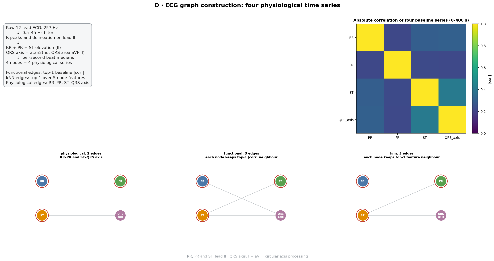
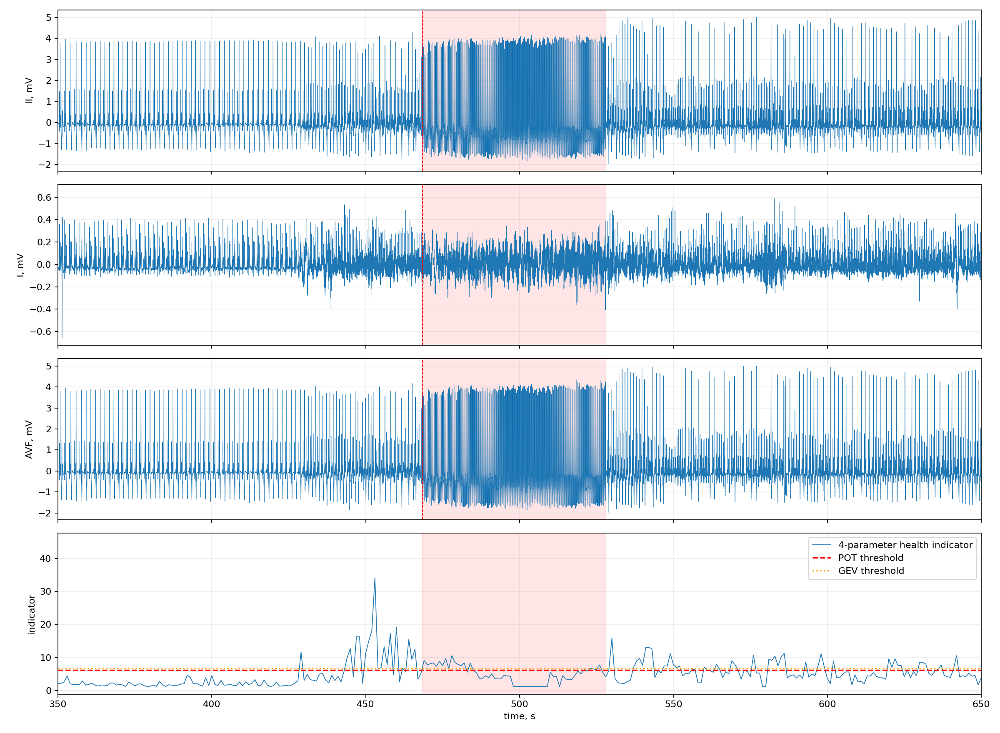
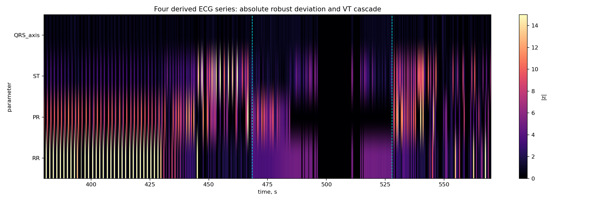

# D · Медицина (ЭКГ) / Medicine (ECG) — 75 записей INCART / 75 INCART recordings

Воспроизведение / Reproduce:

```bash
python scripts/fetch_data.py --only incart   # все 75 записей, 225 файлов, около 798 МБ
python scripts/run_all.py --only ecg
python src/case_figures.py --only D
```

Расчёт / Computation: [`src/ecg_incart_pipeline.py`](../../src/ecg_incart_pipeline.py).
Результаты / Results: [`reference_results/ecg/results.json`](../../reference_results/ecg/results.json), [`episode_latencies.csv`](../../reference_results/ecg/episode_latencies.csv).
Рисунки / Figures: [шесть шагов](../../figures/D_six_steps.png) · [граф](../../figures/D_graph_construction.png) · [четыре ряда I42](../../figures/D_parameter_cascade.png) · [WHEN I42](../../figures/D_evt_detection.png) · [каскад I42](../../figures/D_vt_cascade.png).

---

## 1. Набор данных и задача / Dataset and task

**RU.** Используются **все 75 записей** [St Petersburg INCART 12-lead Arrhythmia Database v1.0.0](https://physionet.org/content/incartdb/1.0.0/), DOI 10.13026/C2V88N. Загрузчик получает `I01–I75` в форматах `.dat/.hea/.atr` и официальный `SHA256SUMS.txt`; каждый из 225 файлов проверяется по SHA-256.

Существующее правило находит подходящие эпизоды ЖТ в **8 записях**: всего **31 эпизод** с началом не раньше 400 с. Остальные **67 записей** не содержат ЖТ по этому правилу. Для каждой записи строятся четыре физиологических ряда; для каждого эпизода рассчитываются четыре латентности. Таким образом, шестой рисунок содержит независимые пары «эпизод × параметр», а не повторные превышения одной записи.

**EN.** All **75 INCART recordings** are downloaded and checksum-verified. Eight recordings contain **31 eligible VT episodes**, while 67 have no VT under the existing annotation rule. Each episode contributes up to four independent episode-by-parameter onset points.

## 2. Четыре ряда из сырой ЭКГ / Four series from raw ECG

Для RR, PR и ST заранее выбрано **отведение II** как стандартное ритмическое с различимыми P и R. Четвёртый параметр использует связь между отведениями:

1. **RR, с** — медиана интервалов между последовательными R-пиками II.
2. **PR, с** — от начала P до начала QRS на II; принимается при `P quality ≥ 3` и длительности 80–320 мс.
3. **Подъём ST, мВ** — сигнал II на J+60…80 мс минус изоэлектрическая база.
4. **Средняя фронтальная ось QRS, °** — `atan2(A_aVF, A_I)` от чистых площадей QRS в aVF и I.

Основной EVT-индикатор использует односекундные медианы. Каскад строится на версии тех же четырёх рядов с окном **250 мс**. Ось обрабатывается циркулярно: кратчайшее отклонение в каскаде и `sin/cos` в индикаторе, без скачка на ±180°. Ненадёжный PR остаётся пропуском до каузального заполнения; маска прямых измерений сохраняется.

**EN.** RR, PR and ST come from lead II; the fourth series is the frontal QRS axis computed from I and aVF. EVT uses one-second series, while recruitment uses 250 ms windows. Circular processing avoids an artificial ±180° discontinuity. PR quality control and the direct-measurement mask are retained.

## 3. Граф и протокол без утечки / Graph and leakage-safe protocol

Узлы каждого эпизода — `RR`, `PR`, `ST`, `QRS_axis`. Для узла вычисляются среднее, стандартное отклонение, DFA, автокорреляция лага 1 и MAD первой разности на предсобытийном интервале.

- **physiological:** `RR–PR`, `ST–QRS_axis`;
- **functional:** top-1 по корреляциям фона записи; сводный граф использует среднюю корреляцию по записям;
- **kNN:** top-1 по пяти признакам узла эпизода; сводный граф использует средние признаки;
- **empty:** контроль без рёбер.

Все три сводных графа содержат соответственно **2, 3 и 3 ребра**. GAT/MLP/LR обучаются на парах «эпизод × параметр». Разбиение **record** группируется по записи, поэтому эпизоды одной записи не попадают одновременно в обучение и тест. Графы эпизодов не имеют межзаписевых рёбер.



## 4. Детекция и представительная запись I42 / Detection and representative I42

Для каждого эпизода вычисляются POT/GPD и GEV-тревоги; полные результаты — `episode_detection.csv`. На рисунках сырого сигнала I42 сохранён как заранее выбранный представительный случай: основная ЖТ **468,436–527,907 с**, POT-тревога **450 с**, GEV **440 с**. Покрытие эталонных R-пиков I42 с допуском 80 мс — **99,94%**.

Представительная визуализация не заменяет многозаписевой расчёт: латентности и модели используют все 31 эпизод.

**EN.** I42 is retained only for representative raw-signal figures. All 31 episodes contribute to the cascade tables and models. Detailed per-episode POT/GEV alarms are stored in `episode_detection.csv`.



## 5. Многозаписевой каскад / Multi-record cascade

Правило для каждого эпизода: **6 MAD, два окна по 250 мс подряд**. Фон — первые 400 с записи. Окно поиска начинается не более чем за 120 с до ЖТ и не раньше чем через 60 с после предыдущей ЖТ в той же записи. Это не позволяет раннему событию порождать повторные латентности для всех последующих эпизодов.

Получено **52 вовлечения из 124 возможных**:

| Параметр | Вовлечено эпизодов | Медиана латентности относительно ЖТ |
|---|---:|---:|
| RR | 13 из 31 | −118,471 с |
| PR | 14 из 31 | −90,185 с |
| ST | 13 из 31 | −118,471 с |
| QRS axis | 12 из 31 | −113,187 с |

На шестом panel каждая точка — вовлечение одного параметра в одном эпизоде. Горизонтальная координата — **начало вовлечения минус аннотированное начало соответствующей ЖТ**; это позволяет показать все 52 точки, включая эпизоды без POT-тревоги. Строка `n=…` теперь показывает число эпизодов с вовлечением параметра.

По среднему EVT-следу и остатку лидирует ST, по медиане латентности раньше остальных вовлекается RR. Это физиологические параметры, а не анатомическая локализация очага. Значения вблизи левой границы означают вовлечение уже в начале окна поиска, а не доказанное истинное начало изменения.

**EN.** The cascade yields **52 recruited episode-parameter points** across 31 VT episodes. Each point is the first 6-MAD recruitment over two consecutive 250 ms windows. The sixth panel uses latency relative to each annotated VT onset. Boundary-adjacent values indicate recruitment already present at the start of the search window, not a proven physiological onset.



## 6. Ограничения и модели / Limitations and models

Прямое измерение PR остаётся трудным во время ЖТ; заполненные значения не являются клинической разметкой. Проверка предвестника на представительной I42 не подтверждает рост шума или дисперсии. ГНС не показывает прогностического преимущества при разбиении по записи: physiological GAT AUROC **0,473 ± 0,046**, empty graph **0,458 ± 0,017**. Это независимая проверка на восьми записях, но выборка эпизодов всё ещё мала и несбалансирована.

**EN.** PR measurements remain unreliable during VT. The representative precursor analysis is negative. Under record-grouped validation, GAT does not outperform the empty graph: AUROC 0.473 ± 0.046 versus 0.458 ± 0.017. The multi-record design removes single-record pseudo-replication but remains limited to eight VT-containing recordings.


