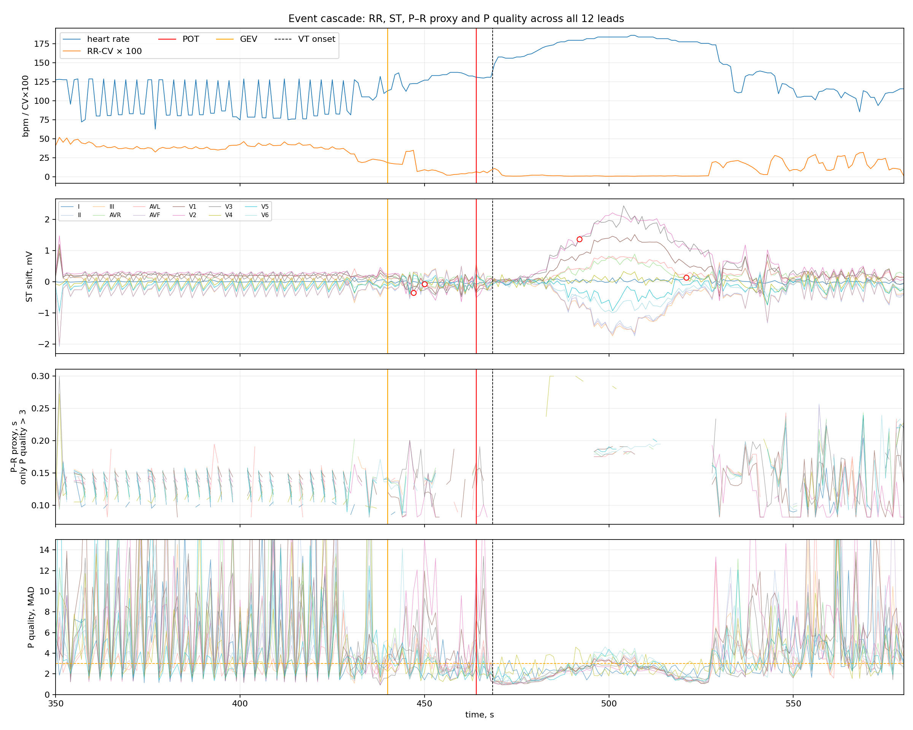

# D · Медицина (ЭКГ) / Medicine (ECG) — желудочковая тахикардия / ventricular tachycardia

Воспроизведение / Reproduce:

```bash
python scripts/fetch_data.py --only incart
python scripts/run_all.py --only ecg
python src/case_figures.py --only D
```

Расчёт / Computation: [`src/ecg_incart_pipeline.py`](../../src/ecg_incart_pipeline.py).
Результаты / Results: [`reference_results/ecg/results.json`](../../reference_results/ecg/results.json).
Рисунки / Figures: [шесть шагов](../../figures/D_six_steps.png) · [преобразование и граф](../../figures/D_graph_construction.png) · [event cascade RR/ST/PR](../../figures/D_parameter_cascade.png) · [WHEN](../../figures/D_evt_detection.png) · [WHERE](../../figures/D_vt_cascade.png).

---

## 1. Постановка задачи / Problem statement

**RU.** По одной 30-минутной 12-канальной ЭКГ нужно ответить на два вопроса: **когда** нетипичная активность становится экстремальной и **где** на системе отведений она проявляется раньше. Используется та же однозаписевая методика, что для остальных примеров: преобразование сигнала → признаки узлов → граф → EVT-индикатор → порог → каскад.

**EN.** A single 30-minute 12-lead ECG is used to answer two questions: **when** does abnormal activity become extreme and **where** on the lead system does it appear first. The same single-record workflow as in the other cases is used: signal transformation → node features → graph → EVT indicator → threshold → cascade.

## 2. Исходные данные и преобразование / Raw data and transformation

**RU.** [St Petersburg INCART 12-lead Arrhythmia Database v1.0.0](https://physionet.org/content/incartdb/1.0.0/), DOI 10.13026/C2V88N, запись **I42**: ЖТ **468,436–527,907 с**, 175 сокращений, средняя ЧСС 175,55 мин⁻¹. Фон — первые 400 с.

Исходные отведения фильтруются на 0,5–45 Гц. По отведению II находятся R-пики только по сигналу; покрытие эталонных позиций с допуском 80 мс — 0,9994. Для каждого отведения затем вычисляются:

- **RR и ЧСС** в каузальном четырёхсекундном окне;
- **ST-сдвиг** — медиана ЭКГ 78–121 мс после R минус база 350–233 мс до R, в мВ;
- **P–R proxy** — задержка P-кандидата до R-пика, только для описательного анализа;
- **P quality** — амплитуда P-кандидата в робастных MAD участка перед ним.

P–R proxy не является клиническим PR от начала P до начала QRS и **не входит в EVT-индикатор**. Низкое P quality означает ненадёжное измерение, а не PR=0.

**EN.** We use INCART **I42**, DOI 10.13026/C2V88N, with VT at **468.436–527.907 s**, 175 beats and mean HR 175.55 bpm. The first 400 s form the baseline. Raw leads are filtered at 0.5–45 Hz and R peaks are detected from lead II using only the signal; post-hoc coverage within 80 ms is 0.9994. Each lead is transformed into heart rate and RR-CV, ST shift (78–121 ms after R relative to the pre-R baseline), a descriptive P–R proxy and a P-quality score. The proxy is not a clinical PR interval and is excluded from the EVT indicator; low quality means unreliable measurement, not zero PR.

## 3. Применение Graph-EVT-agent / Applying Graph-EVT-agent

**RU.** Узлы — ровно 12 отведений. Индикатор состояния включает ЧСС, отрицательный RR-CV и 12 ST-рядов; ковариация Ledoit–Wolf оценивается по фону. Графы:

- **structural — 30 рёбер:** полносвязные группы limb и precordial;
- **functional — 28 рёбер:** top-3 соседа по `|corr|` ST-рядов фона;
- **kNN — 25 рёбер:** top-3 соседа по 15 стандартизированным признакам узла, включая ST-среднее и стандартное отклонение;
- **empty** — контроль без рёбер.

GAT/MLP/LR используются как вспомогательная проверка, а не как замена EVT.

**EN.** Nodes are exactly the 12 leads. The state indicator combines heart rate, negative RR-CV and the 12 ST series. Structural edges complete the two lead groups (30). Functional edges keep top-3 baseline ST-correlation neighbours (28). kNN keeps top-3 neighbours over 15 standardized node features (25). An empty graph and GAT/MLP/LR are auxiliary comparisons, not replacements for EVT.


## 4. Методика «когда» / How WHEN is found

**RU.** POT/GPD: хвост выше квантили 0,8 фона, `gamma=0,999`, три секунды подряд. GEV: максимумы блоков 10 с, `gamma=0,99`, два блока подряд.

- POT: первая событийная тревога **464 с**, **за 4,436 с до начала ЖТ**;
- GEV: первая событийная тревога **440 с**, **за 28,436 с до начала ЖТ**;
- локальный POT с фоном 168–438 с: 489 с (+20,564 с);
- ложных тревог POT и GEV на 1220,5 с нормального теста нет.

**EN.** POT alarms at **464 s**, 4.436 s before the reference VT onset; GEV alarms at **440 s**, 28.436 s before onset. The local POT detector alarms at 489 s (+20.564 s). No false alarms are observed on 1220.5 s of normal test data.


## 5. Методика «где» / How WHERE is found

**RU.** Для каждого отведения вычисляется абсолютное отклонение ST от медианы фона 0–400 с и нормируется MAD. Вовлечение — `|z| > 6` три секунды подряд:

| Отведение | Латентность относительно начала ЖТ |
|---|---:|
| V2 | −21,436 с |
| V1 | −18,436 с |
| V3 | +23,564 с |
| I | +52,564 с |

Ранний ST-след находится в `V1–V2`; остальные восемь отведений порог не проходят. Это не анатомическая локализация очага ЖТ.

**EN.** Per-lead absolute ST deviations are robustly normalised against the 0–400 s baseline. Recruitment requires `|z| > 6` for three consecutive seconds. V2 and V1 are recruited first, followed by V3 and I. The other eight leads do not cross the threshold. This is an informational surface-lead footprint, not an anatomical localisation of the VT focus.


## 6. Результат и ограничения / Result and limitations

**RU.** Мощность 15–45 Гц в четырёх 30-секундных окнах перед ЖТ меняется как `1 → 1,133 → 1,247 → 2,842`; ни один из 17 суррогатных наклонов не больше наблюдаемого. Доля сокращений с `P quality > 3`: фон **49,9%**, предсобытийный интервал **41,2%**, ЖТ **19,8%**, после восстановления **55,5%**. Поэтому числовой P–R proxy не трактуется как клинический PR.

Вовлечены 4 узла из 12, поэтому выводы о преимуществе GAT ограничены. Основной результат — преобразование ЭКГ в RR/ST, ранняя EVT-детекция и пространственный ST-каскад. Индикатор выбран при exploratory-разработке на I42: это демонстрация обнаружимости предвестника, а не независимая оценка качества прогноза.

**EN.** The 15–45 Hz power increases across all leads before VT. P quality exceeds 3 in 49.9% of baseline beats but only 19.8% of VT beats, so the P–R proxy is descriptive rather than clinical. Only 4 of 12 nodes are recruited, limiting GNN conclusions. The main result is the RR/ST transformation, early EVT detection and spatial ST cascade. This single-record exploratory analysis demonstrates precursor detectability, not independently validated prediction performance.

Дополнительный `ecg_parameter_cascade.png` показывает сами RR, ST, P–R proxy и P quality по всем 12 отведениям, без замены ненадёжных измерений меткой `not recruited`.


